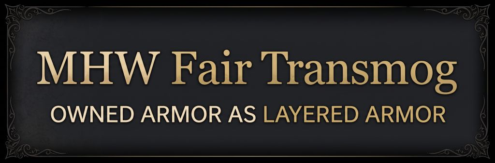
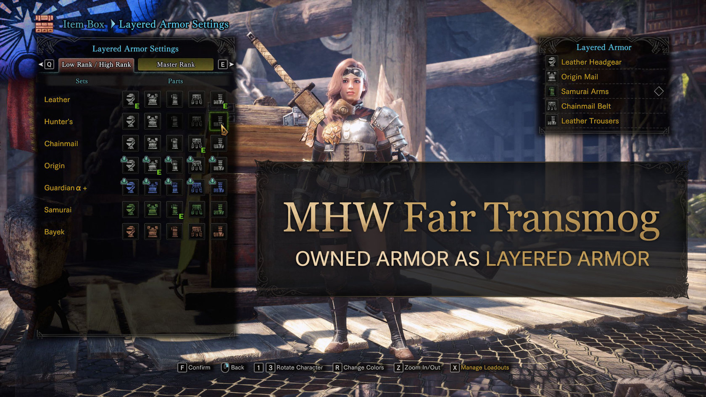

# MHW Fair Transmog



Wear the look of real armor you own as layered armor, selectable in-game from the Equipment Box menu.

Or edit the mod's `MHW-FairTransmog.ini` directly, selecting any armor set ID for any slot that set has a piece for, with hot-reload.

*OR* enable `SuperCheat` option to instantly unlock *every* armor in the game as a Layered Armor and preview it in-game from the Equipment Box.

## Features



### Fair transmog: owned armor as layered armor

- Real armor you own shows up in **Equipment Box → Layered Armor Settings**, next to the regular layered sets (at the top of the list).
- Only pieces you actually own can be picked. If you own just the helm and chest of a set, only those two are selectable.
- Whole sets, single pieces, full-body armor, pigment and layered loadouts all work through the game's own menu, exactly like normal layered armor.
- Your choice is saved by the game like any layered armor and survives quests, area changes and reloading.
- If a piece you are wearing as layered armor leaves your equipment box (for example when you sell it), it is removed from your layered armor the next time the game refreshes your look (changing area, starting a quest, reloading, or changing layered armor). Until then the look stays.
- Master rank armor is listed in the master rank tab, which the game shows according to its own story requirements (not yet tested on a master rank character).

### "Cheat" mode: any armor set

Off by default. `MHW-FairTransmog.ini` is created next to the plugin on first launch:

```ini
[Transmog]
All=-1
Head=-1
Chest=-1
Arms=-1
Waist=-1
Legs=-1
```

- Put an armor set ID in a slot to show that set's piece there, owned or not. [ARMOR_IDS.md](ARMOR_IDS.md) lists every ID, sorted by rarity.
- `All` sets all five slots at once. A slot with its own ID uses that one instead, so `All=480` with `Head=190` gives you a Fatalis α+ body with a Samurai helm.
- `-1` (or leaving the value empty) turns a slot off and shows the game's own look again.
- Changes apply within about a second while the game runs; no restart needed. Cheat mode is shown on top of whatever the Layered Armor menu has selected.
- Cheat mode only changes what is drawn. It never writes to your save, equipment or inventory.

### Super-cheat mode: every armor set in the Layered Armor menu

Off by default. Add `SuperCheat=1` under `[Transmog]` in `MHW-FairTransmog.ini`:

- Every armor set (and every piece of it that exists) shows up in **Equipment Box → Layered Armor Settings**, so you can preview and select any of them with the game's own menu, owned or not. Layered sets you have not unlocked are available too.
- Reopen the menu after changing the setting; no restart needed.
- Sets are listed in the same two tabs as other layered armor, so the master rank tab (where most sets live) shows only when the game itself shows it, after the story progress it requires.
- Selecting an unowned piece stores it in your save like any layered armor. With `SuperCheat=0` the plugin removes unowned ordinary armor again the next time the game refreshes your look. Unlocked-by-SuperCheat layered sets stay until you change them.

## Requirements

- Monster Hunter: World: Iceborne on PC, the final Steam version (15.23). The plugin checks the game executable when it starts and does nothing on any other version.
- [Stracker's Loader](https://www.nexusmods.com/monsterhunterworld/mods/1982).
- Tested with Stracker's Loader together with a CRC-bypass plugin (`!CRCBypass.dll`). Other setups are untested.

## Installation

1. Back up your save (Steam: `<Steam>\userdata\<your id>\582010\remote`).
2. Copy `nativePC\plugins\MHW-FairTransmog.dll` into the game's `nativePC\plugins` folder.
3. Start the game. The plugin creates `MHW-FairTransmog.ini` and `MHW-FairTransmog.log` next to itself.

## Uninstalling

Delete `MHW-FairTransmog.dll`, `.ini` and `.log` from `nativePC\plugins`.

Real armor chosen in the Layered Armor menu is stored in your save the same way as layered armor. Without the plugin it will most likely keep showing, but you can no longer select it again. If you want a clean layered setup first, switch those slots to regular layered pieces (or none) before uninstalling.

## Known limitations

- This is a beta, tested offline on a single character. Multiplayer is untested: other players may or may not see your look.
- Mixing a full-body set with other pieces, for example through cheat mode, can leave arms or legs invisible. This is only visual.

## Reporting problems

Include `nativePC\plugins\MHW-FairTransmog.log`. It is rewritten on every launch, so copy it right after the problem happens.

## Credits

Built with [MinHook](https://github.com/TsudaKageyu/minhook). Armor data layouts follow the [MHW-Editor](https://github.com/Synthlight/MHW-Editor) templates. See [THIRD_PARTY_NOTICES.md](THIRD_PARTY_NOTICES.md). Developer documentation: [DEVELOPMENT.md](DEVELOPMENT.md).
